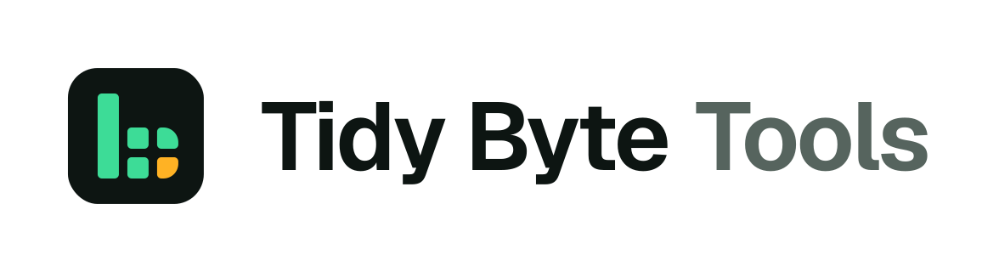

<p>
  <a href="https://github.com/tidybytetools">
    <picture>
      <source media="(prefers-color-scheme: dark)" srcset="https://raw.githubusercontent.com/tidybytetools/json-shaper-lite/main/assets/tidybytetools-lockup-dark.png">
      
    </picture>
  </a>
</p>

# json-shaper-lite

[](https://github.com/tidybytetools/json-shaper-lite/blob/main/LICENSE)
[](https://www.python.org/)
[](#use-it-from-claude-desktop-or-cursor-mcp)
[](https://registry.modelcontextprotocol.io/v0/servers?search=io.github.tidybytetools/json-shaper-lite)
[](https://pypistats.org/packages/json-shaper-lite)

Free tool that turns `key: value` notes, CSV/TSV and Markdown tables into clean JSON.
Need app logs or US addresses parsed too? The paid version does that: **[json-shaper on Gumroad](https://tidybyte.gumroad.com/l/cznmeo)**

Plain code, not AI, so the same text always gives the same JSON. Runs on your own computer. MIT license. Works with Python 3.10 and newer, on Windows, Mac and Linux.

Also searched as: ES: convertir CSV a JSON, notas a JSON / PT: converter CSV para JSON / DE: CSV in JSON umwandeln / FR: convertir un CSV en JSON / JA: CSVをJSONに変換

## Links

- **[Website](https://tidybytetools.github.io/tools/json-shaper/)** — product page with prices and options
- **[Pro version on Gumroad](https://tidybyte.gumroad.com/l/cznmeo)** — app logs and US address parsing

<!-- mcp-name: io.github.tidybytetools/json-shaper-lite -->

## Before and after

Before (a small table or `key: value` notes):

```
name: Ada
city: London
```

After:

```json
{"name": "Ada", "city": "London"}
```

CSV, TSV, and Markdown tables work the same way. This free tool makes flat JSON; it does not flatten nested JSON the other direction.

## Install

```
pip install json-shaper-lite
```

Or use pipx, which keeps it in its own space:

```
pipx install json-shaper-lite
```

Want the newest code from GitHub instead?

```
pip install git+https://github.com/tidybytetools/json-shaper-lite
```

Or just download `json_shaper_lite.py` and run it with `python3`. That one file uses only Python's standard library. (Installing with pip also adds the `mcp` package, which the MCP server needs.)

## Use it

```
printf 'Name: Ada\nAge: 36\nActive: yes' | json-shaper-lite
json-shaper-lite export.csv
json-shaper-lite notes.md --format markdown
json-shaper-lite export.csv --json      # {"ok": true, "format": "csv", "data": [...]}
```

Output:

```json
{"name": "Ada", "age": 36, "active": true}
```

Numbers come out as numbers, yes/no and true/false as booleans, and empty or "null" as null. The format is detected for you, or you can set it with `--format kv|csv|markdown`.

From Python:

```python
from json_shaper_lite import shape
shape("x,y\n1,2")  # {'format': 'csv', 'data': [{'x': 1, 'y': 2}]}
```

When you run it in a terminal it prints one short line about the paid version to stderr after the result. It never goes into your JSON output, it only shows when you are looking at a terminal, and `--quiet` turns it off.

## Known limits

- **It makes flat JSON.** It does not flatten or unflatten nested JSON. For that, use a tool like flatten-json.
- **Types are a best guess.** A value like `007` or a zip code can turn into a number. Fix those by hand after.
- **One table per run.** Two Markdown tables in one file get mixed together. Split them first.
- **No app logs or addresses.** Those are in the paid version.

## How it compares to other free tools

| | json-shaper-lite | [flatten-json](https://pypi.org/project/flatten-json/) | csvkit `csvjson` | pandas |
|---|---|---|---|---|
| Main job | messy text → JSON | nested JSON → flat (and back) | CSV → JSON | full data toolkit |
| Install size | one file (pip adds `mcp` for the MCP server) | small | medium | large |
| `key: value` notes | yes | no | no | no |
| Markdown tables | yes | no | no | no, not built in |
| CSV/TSV | yes | no | yes | yes |
| Guesses numbers and true/false | yes | no | yes | yes |
| Nested JSON flatten/unflatten | no | yes | no | yes (`json_normalize`) |
| MCP server for AI apps | yes | no | no | no |

If your data is already JSON and just too nested, flatten-json is the better pick.

## Use it from Claude Desktop or Cursor (MCP)

There is a small free MCP server built in. It gives your AI app two tools. Both only read. They never write or change files, and they never use the internet. It needs [uv](https://docs.astral.sh/uv/).

Run it by hand to check it starts (it waits quietly for an app to talk to it):

```
uvx json-shaper-lite mcp
```

Claude Desktop (`claude_desktop_config.json`) or Cursor (`~/.cursor/mcp.json`):

```json
{
  "mcpServers": {
    "json-shaper-lite": {
      "command": "uvx",
      "args": ["json-shaper-lite", "mcp"]
    }
  }
}
```

`uvx --from json-shaper-lite json-shaper-lite-mcp` starts the same server.

Tools:

- `shape_text_to_json(text, format="auto")`: for text in the chat.
- `shape_file_to_json(path, format="auto")`: for a text file on your computer (.txt, .csv, .tsv, .md, up to 5 MB).

Both return `{"format": "csv", "data": [...]}`. `format` can be `auto`, `kv`, `csv` or `markdown`.

## For AI agents

- **Use when:** you have plain text in `key: value` lines, CSV/TSV, or a Markdown table and need typed JSON.
- **Don't use when:** the input is already JSON, it's app logs, or it's nested data. Use the paid version for logs.
- **Input:** text on stdin or a file path. Optional `--format kv|csv|markdown`.
- **MCP:** `uvx json-shaper-lite mcp` gives two read-only tools, `shape_text_to_json` and `shape_file_to_json`.
- **Output:** with `--json`, one object: `{"ok": true, "format": "csv", "data": [...]}`. On error `ok` is false. Exit code 0 ok, 1 error.
- Hint lines go to stderr only, and only in a terminal, so stdout is always clean JSON. See also [`llms.txt`](https://github.com/tidybytetools/json-shaper-lite/blob/main/llms.txt).

## Lite vs paid

| | lite (free) | [json-shaper](https://tidybyte.gumroad.com/l/cznmeo) |
|---|---|---|
| key: value notes, CSV/TSV, Markdown tables | yes | yes |
| App logs (timestamp, level, message, key=value fields) | no | yes |
| One-line US address splitter | no | yes |
| `tool.json` manifest for scripts and AI agents | no | yes |

## Tests

```
pip install "mcp>=1.10,<2"
python3 -m unittest discover tests
```

The MCP tests are skipped if `mcp` is not installed.

## FAQ

**What input does it take?**
key: value notes, CSV/TSV, or a Markdown table.

**Do my files leave my computer?**
No. The tool runs on your computer and never uses the internet.

**How is this different from the Pro version?**
Pro also parses app logs and one-line US addresses.

**Does it work with AI apps?**
Yes. It includes a free MCP server. No API key.
## License

MIT. See `LICENSE`.
